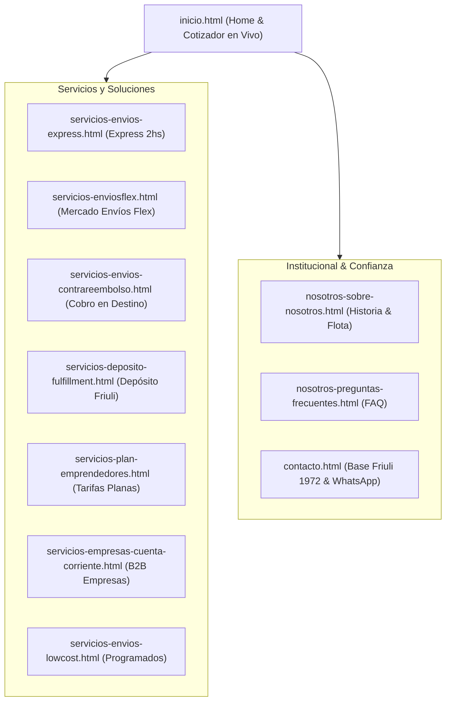

# Sistema de Diseño y Definición Integral del Sitio
## Envíos DosRuedas — Logística y Mensajería Urbana (Mar del Plata)
*Auditoría de Archivos Existentes (`actuales/`), Identidad Visual, Arquitectura Web y Sistema Canónico de Componentes.*

---

## 1. Visión y Dirección Creativa de la Marca

> **Perspectiva de Dirección de Arte (`design-artifact`):**  
> Envíos DosRuedas no es una plantilla corporativa genérica ni una aplicación internacional impersonal de delivery (como PedidosYa o Uber). Su identidad visual debe comunicar **energía urbana costera, inmediatez física, arraigo local en Mar del Plata y confiabilidad absoluta**.  
> El valor clave es **"Flota propia, cero tercerización y base física en Friuli 1972"**. El diseño debe transmitir la solidez de una empresa real con choferes contratados, no de un software etéreo.

### El Registro Visual: *Editorial Dinámico / Logística de Alta Precisión*
- **Tono general:** Enérgico, limpio, estructurado y directo. No debe parecer un folleto artesanal ni una plantilla SaaS con degradados morados cliché de IA.
- **Atmósfera:** Contraste fuerte entre azul marino eléctrico/profundo y destellos amarillos de alta visibilidad (inspirados en la indumentaria de tránsito, chalecos reflectivos y la señalética vial de Mar del Plata).

---

## 2. Auditoría y Radiografía de `actuales/` (12 Páginas)

Se analizaron en profundidad los 12 archivos HTML que componen la versión actual del sitio:

| Archivo | Rol en el Embudo | Título y Propósito | Hallazgos Críticos y Deuda Técnica |
| :--- | :--- | :--- | :--- |
| **`inicio.html`** | Portada Principal | *Mensajería en moto en Mar del Plata* (Home). Presenta todos los segmentos. | **Monolítico (3.342 líneas)**. Contiene Tailwind CDN, Lucide CDN, Google Fonts y CSS duplicado. El CTA de cotizar lleva a otra página sin cotizador en vivo. |
| **`servicios-envios-express.html`** | Servicio Core B2C/B2B | Entregas urgentes punto a punto en menos de 2 horas. | Excelente propuesta de inmediatez. Faltan selectores interactivos de radio por zonas urbanas. |
| **`servicios-enviosflex.html`** | Solución Ecommerce | Mercado Envíos Flex y logística para vendedores de ML y Tiendanube. | Crucial para captar tiendas. Explica bien el corte de las 14:00/15:00 hs, pero tiene código de estilos redundante. |
| **`servicios-envios-contrareembolso.html`**| Solución Comercial | Cobro en destino (efectivo/transferencia) y rendición en 24hs. | Gran tracción para emprendedores que no quieren fiar. Requiere explicador visual del circuito de rendición. |
| **`servicios-deposito-fulfillment.html`** | Servicio Logístico B2B | Almacenamiento de stock, picking y empaque en Friuli 1972. | Código etiquetado como `EmprendedoresHero.tsx`. Hay desfase semántico con el título. |
| **`servicios-plan-emprendedores.html`** | Producto Suscripción | Tarifas planas por volumen para marcas marplatenses en crecimiento. | Contiene tabla de precios que merece mayor jerarquía y comparativa limpia. |
| **`servicios-empresas-cuenta-corriente.html`** | Corporativo B2B | Facturación A mensual, cadetes asignados para bancos y distribuidoras. | Tono sobrio, pero visualmente clonado de las páginas de cadetería particular. |
| **`servicios-envios-lowcost.html`** | Cadetería Económica | Envíos programados no urgentes a tarifa reducida. | Riesgo de canibalizar el servicio Express; debe quedar claro el compromiso de horario. |
| **`contacto.html`** | Conversión / Soporte | Formulario de contacto, ubicación de Base Friuli 1972 y enlaces directos. | Muy pesado (1.927 líneas para un formulario). Debe ser el archivo más rápido del sitio. |
| **`nosotros-sobre-nosotros.html`** | Confianza / Marca | Historia de la empresa, fotos del equipo, flota propia y base operativa. | Valioso para SEO local y legitimidad. Debe potenciar la prueba social. |
| **`nosotros-preguntas-frecuentes.html`** | Soporte / Derivación | Respuestas sobre zonas de cobertura, lluvia, roturas y pagos. | Estructura de acordeón funcional, pero los scripts están repetidos in-page. |
| **`nosotros-nuestras-redes.html`** | Comunidad | Hub de Instagram, WhatsApp, TikTok y testimonios de clientes. | Puede integrarse como sección dentro de "Sobre Nosotros" para evitar páginas huérfanas. |

---

## 3. Sistema de Tokens Canónico (La Fuente de Verdad)

Actualmente conviven dos variantes del azul en el repositorio (`#0950F6` en Tailwind y `#0C3BA7` en prompts de rebranding). Establecemos la especificación canónica con roles semánticos cerrados:

### 3.1. Paleta Cromática y Reglas de Contraste (WCAG 2.2 AA)

```
        AZUL MARCA               AMARILLO VIAL              AZUL PROFUNDO (INK)
         #0950F6                    #FFEC01                       #071536
    [Fondos principales]        [Acento y acción]           [Tipografía de lectura]
```

| Nombre del Token | Valor Hex | Rol Semántico de Diseño |
| :--- | :--- | :--- |
| `--edr-blue-primary` | `#0950F6` | Color principal de marca: fondos hero, navegación, botones secundarios activos. |
| `--edr-blue-dark` | `#0740C7` | Hover del azul primario y fondos de tarjetas elevadas en modo oscuro. |
| `--edr-blue-surface` | `#EBF2FE` | Tinte sutil para fondos de secciones alternas, chips de filtros y badges. |
| `--edr-yellow-accent` | `#FFEC01` | **Acento de alta visibilidad**: Botones principales (CTAs), subrayados y badges. |
| `--edr-yellow-hover` | `#E6D400` | Estado hover de botones amarillos. |
| `--edr-ink` | `#071536` | Neutro dominante para títulos y texto principal sobre fondo claro. |
| `--edr-text-secondary`| `#4A5C82` | Texto secundario y descripciones de párrafos. |
| `--edr-white` | `#FFFFFF` | Superficies de tarjeta, texto sobre fondo azul primario y base clara. |
| `--edr-border` | `#D6E2FB` | Bordes estructurales, divisores y contornos de inputs. |

> [!IMPORTANT]
> **Regla de oro de legibilidad:**  
> Cualquier texto o icono sobre fondo `--edr-yellow-accent` (`#FFEC01`) **DEBE ser obligatoriamente azul oscuro (`#071536` o `#0950F6`)**. El texto blanco sobre amarillo queda terminantemente prohibido por violar los estándares de accesibilidad visual.

### 3.2. Estrategia de Temas (Claro y Oscuro en Tokens)

El tema no debe depender de clases de Tailwind esparcidas elemento por elemento; se gobierna exclusivamente mediante reasignación de variables en `:root`:

```css
/* Tokens Globales */
:root {
  --bg-page: #F8FAFF;
  --bg-surface: #FFFFFF;
  --bg-surface-elevated: #FFFFFF;
  --border-subtle: #D6E2FB;
  --text-main: #071536;
  --text-muted: #4A5C82;
  --brand-blue: #0950F6;
  --brand-yellow: #FFEC01;
}

/* Modo Oscuro por Atributo y Media Query */
:root[data-theme="dark"],
@media (prefers-color-scheme: dark) {
  :root:not([data-theme="light"]) {
    --bg-page: #050C1E;
    --bg-surface: #0A1738;
    --bg-surface-elevated: #10224F;
    --border-subtle: #1C336B;
    --text-main: #F2F6FF;
    --text-muted: #9BB1D6;
    --brand-blue: #256BFE;
    --brand-yellow: #FFEC01;
  }
}
```

---

## 4. Tipografía y Jerarquía Editorial

La identidad tipográfica de Envíos DosRuedas consta de **tres familias tipográficas en diálogo estricto**:

```
 ┌──────────────────────────────────────────────────────────────┐
 │ ANTON (Display)        → TÍTULOS DE IMPACTO Y GRANDES NÚMEROS│
 │ BEBAS NEUE (Subheading)→ BOTONES, CHIPS, EYEBROWS, PILLS     │
 │ OUTFIT (Sans)          → CUERPO DE LECTURA, PÁRRAFOS, LISTAS │
 │ GEIST MONO (Utility)   → PRECIOS, HORAS, TRACKING TABULAR    │
 └──────────────────────────────────────────────────────────────┘
```

1. **`Anton` (Display Impacto):**
   - Uso: Encabezados `H1` principales del Hero y títulos de sección (`H2`).
   - Propiedades: `letter-spacing: -0.025em; text-transform: uppercase; line-height: 0.95; text-wrap: balance;`.
2. **`Bebas Neue` (Subheading & Action):**
   - Uso: Botones CTAs, pills anidadas, números de teléfono, tarjetas de segmento.
   - Propiedades: `letter-spacing: 0.05em; text-transform: uppercase; font-weight: 700;`.
3. **`Outfit` (Sans para Lectura):**
   - Uso: Párrafos descriptivos, textos legales, preguntas frecuentes, formularios.
   - Propiedades: Medida máxima de línea limitada a `65ch`, `line-height: 1.6; text-wrap: pretty;`.
4. **`Geist Mono` (Datos Utilitarios):**
   - Uso: Códigos de seguimiento (`DR-84920`), franjas horarias (`14:00 - 18:00 hs`), tarifas monetarias con `font-variant-numeric: tabular-nums;`.

---

## 5. Arquitectura de Información y Estructura del Sitio

Para eliminar redundancias entre los 12 archivos de `actuales/`, el mapa del sitio se consolida en una estructura de 3 pilares lógicos:



---

## 6. Catálogo Canónico de Componentes Transversales

Para que cualquier página nueva o refactorizada mantenga una coherencia absoluta, se definen los siguientes componentes estándar:

### 6.1. `HeaderOptimizado` (Cabecera Global)
- **Barra fija (`sticky top-0 z-40`):** Fondo azul con `backdrop-filter: blur(12px)`.
- **Elementos:**
  1. Logotipo oficial con isotipo de moto e imagotipo "Envíos DosRuedas".
  2. Menú de navegación desktop con dropdown semántico para *Servicios* y *Nosotros*.
  3. Selector de tema rápido (icono Sol/Luna).
  4. Botón directo a WhatsApp con microinteracción hover (`transform: translateY(-2px)`).
  5. Menú hamburguesa accesible para dispositivos móviles con foco atrapado y cierre por tecla `Escape`.

### 6.2. `TickerDiferenciales` (Marquee Continuo)
- **Ubicación:** Inmediatamente debajo del Hero en la Home y páginas de aterrizaje.
- **Contenido obligatorio:**
  `Envíos en el día · Flota propia · Cero tercerización · Todo Mar del Plata · Base Friuli 1972 · Retiro en tu local`.
- **Diseño:** Fondo translúcido `rgba(255,255,255,0.1)`, rombos amarillos separadores `#FFEC01` y respeto a `prefers-reduced-motion` (pausado o scroll estático si el usuario lo prefiere).

### 6.3. `DoubleBezelCard` (Tarjeta de Servicio con Doble Bisel)
- **Concepto:** Tarjeta con doble borde sutil (`border: 1px solid var(--border-subtle)` exterior, relleno `var(--bg-surface)` y borde interior al hover).
- **Detalle característico:** Número de orden en marca de agua translúcida (`01`, `02`, `03`) colocado en la esquina superior derecha con fuente `Anton`.
- **Efecto hover:** Elevación suave (`translateY(-3px)`) con sombra tintada de azul.

### 6.4. `CotizadorWidget` (Cotizador Rápido de Portada)
- **Lógica:** Selección de zona de retiro, zona de entrega, tamaño del paquete y modalidad (Express vs Flex).
- **Salida:** Precio dinámico en pesos argentinos en tipografía monoespaciada tabular, tiempo estimado de entrega y botón para enviar el pedido formateado a WhatsApp en un solo clic.

### 6.5. `FooterInstitucional` (Pie de Página Oficial)
- **Fondo:** Azul profundo `#071536` con borde superior sutil.
- **Columnas:**
  1. Identidad de marca, dirección física (**Friuli 1972, Mar del Plata**) y horarios de atención (Lunes a Viernes 8:00 a 20:00 hs, Sábados 9:00 a 14:00 hs).
  2. Enlaces directos a los 7 servicios.
  3. Enlaces a soporte, FAQ y contacto.
  4. Badges de seguridad, métodos de pago aceptados (Efectivo, Transferencia, Mercado Pago, Cuenta DNI).

---

## 7. Directrices de Redacción y Voz de Marca

Bajo las reglas de `design-artifact`, el texto es un **material de construcción estructural**, no un adorno:

| Qué DECIR (Voz Envíos DosRuedas) | Qué EVITAR (Clichés y Genéricos) |
| :--- | :--- |
| *"Llegamos a todo Mar del Plata con repartidores propios."* | *"Soluciones logísticas innovadoras e inteligentes impulsadas por IA."* |
| *"Retiramos en tu local y cobramos en mano al comprador."* | *"Gestión de pasarela de pagos descentralizada."* |
| *"Base operativa en Friuli 1972."* | *"Presencia global multicanal."* |
| *"Cotizá tu envío en 2 clics por WhatsApp."* | *"Haga clic aquí para iniciar una solicitud de cotización."* |
| *"Rendición bancaria de tu dinero en 24 horas."* | *"Optimización del flujo de capital circulante."* |

---

## 8. Guía para Evitar el "Look Cliché de IA" en este Sitio

El skill `design-artifact` exige explícitamente auditar y erradicar los siguientes vicios visuales:

1. **Prohibido el fondo crema con terracota:** El sitio de Envíos DosRuedas debe basarse en blancos fríos, azules náuticos e indumentaria vial amarilla.
2. **Prohibido el degradado morado a azul flotando sobre blanco:** El azul `#0950F6` debe ser sólido o con gradientes lineales limpios hacia azul oscuro, nunca hacia violeta/magenta.
3. **Prohibido el uso de emojis como reemplazo de iconos técnicos:** Utilizar únicamente iconos vectoriales SVG limpios (moto, paquete, reloj, escudo, mapa).
4. **Prohibido el centrado universal:** Los formularios y listados deben alinearse a la izquierda para garantizar una lectura natural y rápida en móviles.
5. **Prohibido el `border-radius: 9999px` indiscriminado:** Las tarjetas de servicios y contenedores de datos deben usar bordes estructurados moderados (`border-radius: 8px` a `14px`), reservando las *pills* redondas únicamente para botones y badges de estado.

---

## 9. Hoja de Ruta de Limpieza Técnica para `actuales/`

1. **Reemplazo de CDNs por activos inline:** Eliminar las llamadas a `cdn.tailwindcss.com` y `unpkg.com/lucide` en producción; compilar el CSS final e incrustar los SVGs inline.
2. **Unificación de variables CSS:** Eliminar las discrepancias de color reemplazando cualquier mención suelta de `#0C3BA7`, `#0840c4` o `#3570F8` por los tokens canónicos `--edr-blue-primary` y derivados.
3. **Reducción de tamaño del archivo `inicio.html`:** El archivo actual de 3.342 líneas puede reducirse a menos de 700 líneas limpias manteniendo exactamente el mismo contenido mediante la unificación de estilos de tarjetas.
4. **Integración del Cotizador en Vivo en la Home:** Trasladar la lógica del cotizador interactivo creado en `propuesta-prototipo-inicio.html` al archivo final de producción.

---

*Documento maestro generado bajo la competencia de `design-artifact` para servir como contrato canónico de diseño y arquitectura de información de Envíos DosRuedas.*
